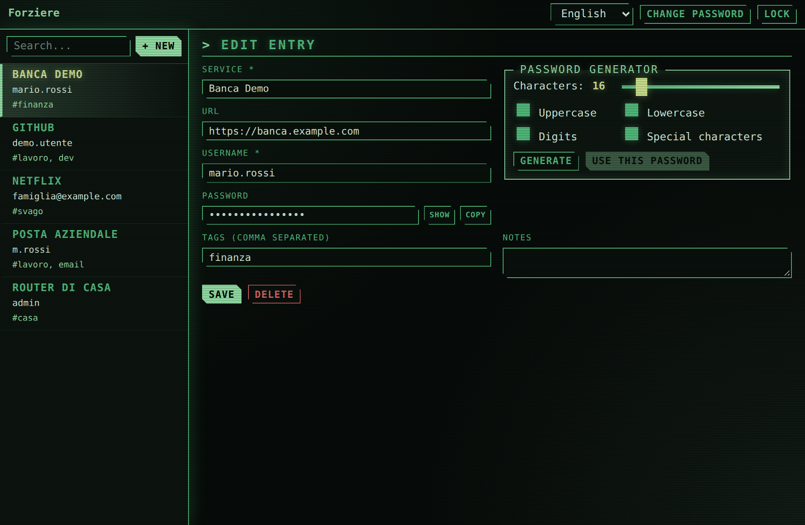
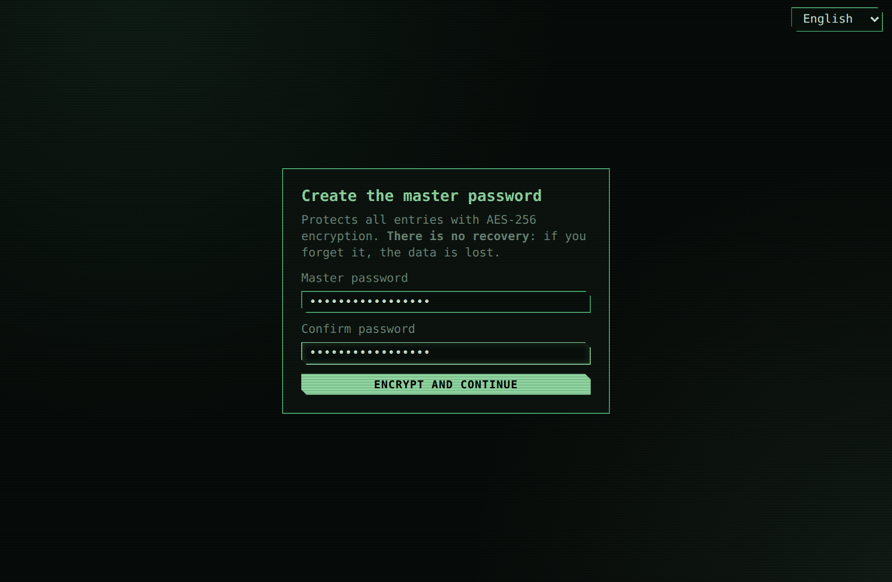
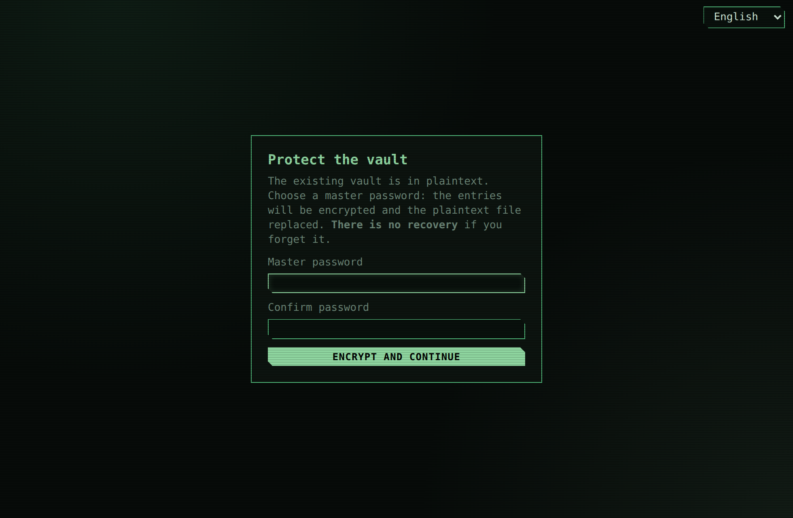
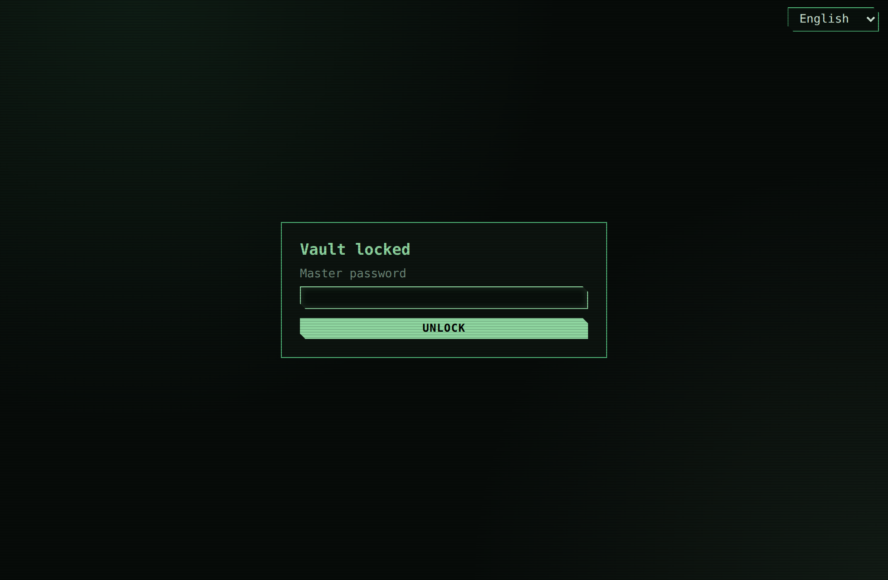
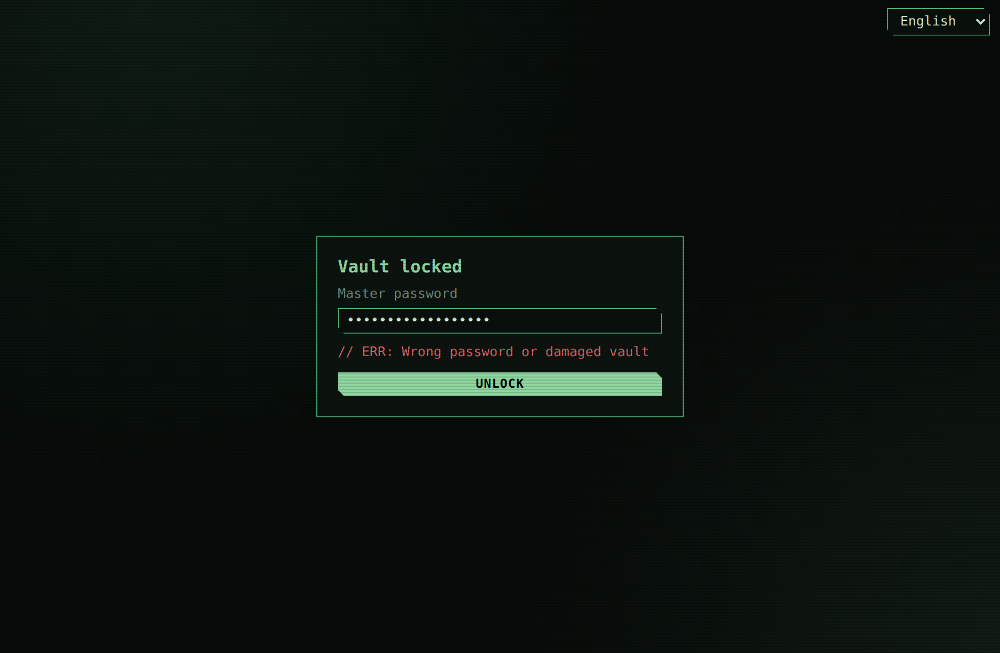
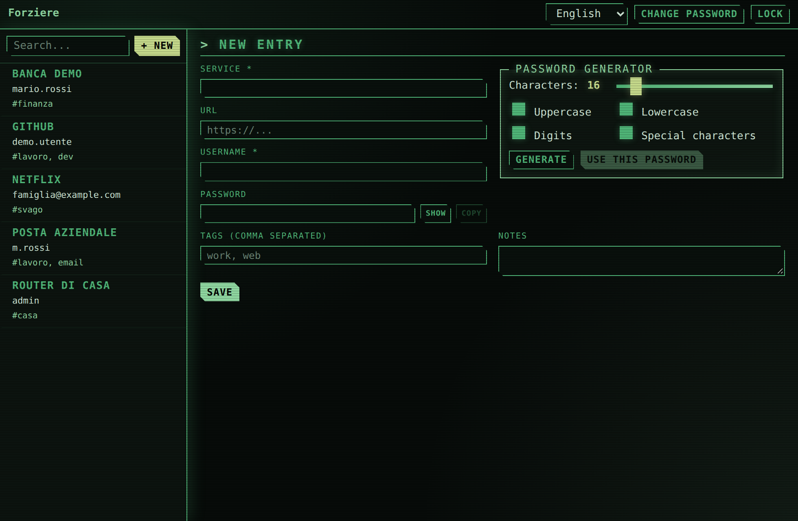
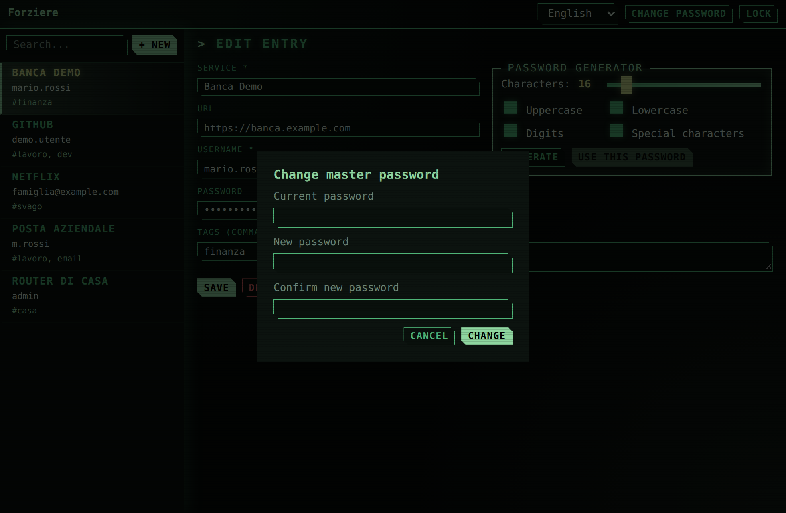

# Forziere

**English** · [Italiano](README.it.md)

Desktop application (Tauri 2 + Vue 3) to store usernames and their passwords and to generate secure passwords.

## Features

- Entry store: service, URL, username, password, notes, tags/category, creation and modification dates.
- Create, edit, delete and search (service, username, tags).
- Configurable secure password generator:
  - number of characters (4–128)
  - uppercase letters on/off
  - lowercase letters on/off
  - digits on/off
  - special characters on/off
  - at least one character for each selected class; randomness from a cryptographic generator.
- Copy the password to the clipboard, show/hide password.
- Vault protected by a **master password**: AES-256-GCM encryption, key derived with Argon2id; *Lock* and *Change password* buttons.
- Multilingual UI (English by default, Italian): language selector in the top bar and on the unlock screen; the choice is remembered.

## Screenshots

Screenshots with made-up sample data, in the English UI (the Italian screenshots are in [`README.it.md`](README.it.md)). The language selector is visible at the top right.

<p align="center">
  
</p>

| | |
|---|---|
| <br>First launch: creating the master password | <br>Migrating a plaintext vault |
| <br>Unlocking the vault | <br>Wrong password |
| <br>New entry | <br>Changing the master password |

## Requirements

- Node.js (>= 20) and npm
- Rust (stable, edition 2024) and cargo
- Tauri system dependencies for Linux: see <https://tauri.app/start/prerequisites/>
- `cargo-audit` (for `npm run regression`): `cargo install cargo-audit --locked`

## Commands

```bash
npm install                # install frontend dependencies
npm run tauri dev          # run the app in development
npm run tauri build        # production build
npm test                   # frontend tests (Vitest)
npm run test:rust          # backend tests (cargo test)
npm run audit:rust         # Rust dependency audit (RustSec, requires cargo-audit and network)
npm run regression         # full regression: frontend + Rust tests + audit + build
```

> **VS Code snap terminal (Linux):** if `npm run tauri dev` crashes with `GLib-GIO-ERROR ... antialiasing`
> or `symbol lookup error ... libpthread`, use `./scripts/dev-clean.sh`, which cleans up the inherited environment variables.

## Build, installation and removal

`npm run tauri build` produces the native packages in `src-tauri/target/release/bundle/` (it must be run on the
target operating system). Full guide for Linux, Windows and macOS, covering installation, uninstallation, signing and
data location (in Italian): [`docs/BUILD-E-INSTALLAZIONE.md`](docs/BUILD-E-INSTALLAZIONE.md).

Linux example (verified): `sudo apt install ./src-tauri/target/release/bundle/deb/Forziere_1.0.0_amd64.deb`
to install, `sudo apt remove forziere` to remove (the data in `vault.json` is not deleted).

### Icon

Source: `design/icon.svg`. To regenerate all sizes (PNG, `.ico`, `.icns`) after a change:

```bash
inkscape design/icon.svg -o design/icon.png -w 1024 -h 1024   # or another SVG renderer
npm run tauri icon design/icon.png
rm -rf src-tauri/icons/android src-tauri/icons/ios            # not needed (desktop-only app)
cp design/icon.svg public/icon.svg                            # frontend favicon
```

## Data

Entries are stored in `vault.json` in the app data folder (`app_data_dir`, typically
`~/.local/share/com.giorgio-marini.forziere/` on Linux). Writes are atomic (temporary file + rename).

### Master password and encryption

- On first launch you create the master password (minimum 12 characters). A plaintext vault created by an earlier
  version is **encrypted in place** the first time it is opened: the plaintext file is replaced.
- All entries (including service names and URLs) are encrypted with **AES-256-GCM**; the key is derived from the
  password with **Argon2id** (19 MiB, 2 iterations, 1 lane, random 16-byte salt). A fresh nonce is used on every
  save; the version and KDF parameters are authenticated, so any modification of the file makes unlocking fail.
- The master password is never stored. **There is no recovery:** if you forget it, the data is lost.
- `vault.json` format (v2): `{ "version": 2, "kdf": {alg, m, t, p, salt}, "nonce", "ciphertext" }` (base64).
- Known limitation: while the vault is unlocked, entries are held in memory in plaintext; the key is zeroed on lock.
  Automatic locking on inactivity and clearing the clipboard are still to do (see `TODO.md`).

## Structure

- `src/` – Vue frontend (components, `api.js` wrapper)
- `design/icon.svg` – icon source (green padlock, cyberpunk style); `design/icon.png` is the 1024×1024 render
- `src-tauri/src/` – Rust backend (`store.rs`, `crypto.rs`, `generator.rs`, Tauri commands in `lib.rs`)
- `docs/screenshots/{en,it}/` – screenshots used in the READMEs, one set per language

## Project documents

- `docs/BUILD-E-INSTALLAZIONE.md` – build, installation and removal per OS (in Italian)
- `TODO.md` – work progress (in Italian)
- `CHANGELOG.md` – change history (in Italian)

## License

Distributed under the [MIT](LICENSE) license.
